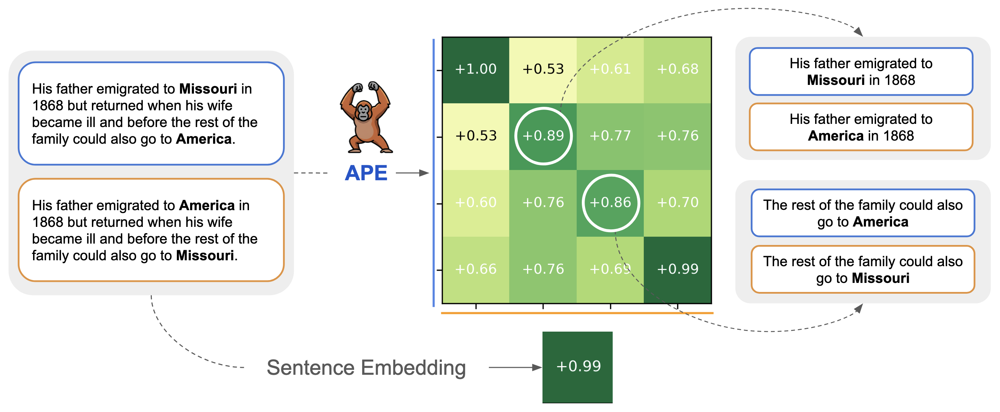
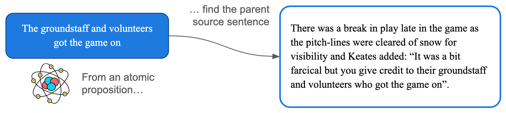

<div align="center">
  

[](link)
[](https://creativecommons.org/licenses/by-nc/4.0/)
[](https://huggingface.co/collections/sapienzanlp/ape)
</div>

> This repository contains the official code for [**Variable-size Discovery and Representation of Atomic Propositions**](https://aclanthology.org/2024.acl-long.722/) ([Francesco Ortame](https://www.linkedin.com/in/francesco-ortame/) and [Roberto Navigli](https://www.linkedin.com/in/robertonavigli/), EMNLP 2026 main).

## Description

APE is an encoder-decoder transformer model that produces variable-size representations from text. For a given input sentence, in a single forward pass APE:

* **Discovers** the set of atomic propositions;
* **Represents** each atomic proposition with an embedding vector.

Differently from fixed-size sentence embeddings, APE representations **scale naturally with input complexity**.



The APE architecture consists of a transformer decoder with learned query vectors on top of a pretrained encoder (specifically, a fine-tuned sentence transformer). The architecture is inspired by transformer models for object detection, like DETR [(Carion et al., 2020)](https://link.springer.com/chapter/10.1007/978-3-030-58452-8_13).

> [!IMPORTANT]
> APE is a proposition-representation model. By design, it represents sentences as **sets of independent, self-contained atomic propositions**. Therefore, between-propositions relationships (causality, conditionality...) are not represented.

## Installation and Usage

To prepare your environment, run:
```bash
git clone https://github.com/SapienzaNLP/APE && cd APE
uv sync   # or pip install -e .
```

### Load a Pretrained APE Model
A pretrained APE model can be loaded from the Hugging Face Hub (or a local directory) with `APE.from_pretrained`:

```python
from ape import APE, APEScore

model = APE.from_pretrained("sapienzanlp/ape-bge-small")

sentences = [
    "Rome was built in 753 BC and is now the capital of Italy.",
    "Rome is the capital of Italy.",
]

prop_embds, act_scores = model.encode(
    sentences,
    activity_threshold=0.6,
    return_scores=True
)

print([e.shape for e in prop_embds])
# [torch.Size([2, 384]), torch.Size([1, 384])]

print("activity scores:", [[round(x, 4) for x in s.tolist()] for s in act_scores])
# activity scores: [[0.9988, 0.9984], [0.9987]]

print("all slot activities:")
for s, row in zip("AB", model.activity_scores(sentences)):
    print(s, [round(float(x), 3) for x in row])
# all slot activities:
# A [0.001, 0.0, 0.999, 0.0, 0.001, 0.998, 0.0, 0.0] -> two active slots
# B [0.0,   0.0, 0.999, 0.0, 0.001, 0.001, 0.0, 0.0] -> one active slot
```

An output vector counts as a proposition embedding if its activity score exceeds `activity_threshold` (we recommend around 0.6 as a starting point). Every sentence is guaranteed to get at least one active embedding.

### Inference Scoring Rules

With APE, sentence-to-sentence comparisons produce cosine similarity matrices. One can aggregate values in these matrices into a single score using different techniques (scoring rules) depending on the task.

| Rule | Description | Task |
|:---|:---|:---|
|`hungarian`|Optimal one-to-one matching between Sentence A and Sentence B, averaged over matched pairs. Symmetric scoring rule (sentence ordering is irrelevant).| Propositional equivalence (e.g., PAWS-style). |
|`maxsim`|Mean of each proposition's best match, averaged over both directions. Symmetric scoring rule (sentence ordering is irrelevant).| General semantic similarity. |
|`pool`|Cosine similarity of the mean-pooled proposition embedding sets. Symmetric scoring rule (sentence ordering is irrelevant). | General semantic similarity. Tends to work worse than `maxsim`. |
|`h_min_to_p`|Worst best-match of any Sentence A-proposition (hypothesis/query) to Sentence B propositions (premise/document). Asymmetric scoring rule (pass hypothesis/query first, then premise/document)| NLI entailment detection; Proposition-level retrieval.¹|

<sub>¹*Note: APE has not yet been trained on query/passage pairs, so typical asymmetric retrieval may not work as intended.*</sub>

Scoring rules can be accessed from the `APEScore` class:

```python
scorer = APEScore(prop_embds[1], prop_embds[0])  # (hypothesis, premise)

print("Hungarian Score: ", round(scorer.score("hungarian"), 3))
print("MaxSim Score:    ", round(scorer.score("maxsim"), 3))
print("Pooled Score:    ", round(scorer.score("pool"), 3))
print("H2P Score:       ", round(scorer.score("h_min_to_p"), 3))

# Hungarian Score: 0.973
# MaxSim Score:    0.939
# Pooled Score:    0.937
# H2P Score:       0.973

# to pretty-print the full cosine similarity matrix
scorer.print_similarity_matrix()
#         B0     B1
# A0   0.838  0.973
```

### Interpretability via Proposition Seeding

APE proposition embeddings are not tied to any text, but they can be interpreted via **proposition seeding**. We encode a candidate atomic proposition (the *seed*) with APE and check which of the sentence's proposition embeddings is the strongest match.

```python
import torch
from ape import APE, APEScore

model = APE.from_pretrained("sapienzanlp/ape-bge-small")

sentence = "Rome was built in 753 BC and is now the capital of Italy."
prop_seeds = [
    "Rome was built in 753 BC.",
    "Rome is now the capital of Italy.",
]

prop_embds = model.encode(sentence)                # [n_propositions, D]
seed_embds = torch.cat(model.encode(prop_seeds))   # one embedding per seed

scorer = APEScore(seed_embds, prop_embds)  # rows: seeds, columns: APE propositions
scorer.print_similarity_matrix()

for seed, j in zip(prop_seeds, scorer.similarity_matrix().argmax(axis=1)):
    print(f"{seed!r} -> proposition B{j}")
```

This will output:

```
        B0     B1
A0   0.996  0.862
A1   0.833  0.985

'Rome was built in 753 BC.' -> proposition B0
'Rome is now the capital of Italy.' -> proposition B1
```

> [!TIP]
> Seeds should be single atomic propositions, so that APE encodes each one into exactly one embedding. A seed that contains several propositions produces several rows in `seed_embds`. If APE mistakenly produces more than one vector for a single atomic proposition, one way around it is to pool the embeddings of the seed before matching.

## Training

APE ([ape-bge-small](https://huggingface.co/sapienzanlp/ape-bge-small)) is trained on [Atomic WikiSplit](https://huggingface.co/datasets/sapienzanlp/atomic-wikisplit), a dataset we introduce alongside the model. This dataset features pairs of sentences and atomic propositions obtained using [gpt-oss-120b](https://arxiv.org/abs/2508.10925).

We designed APE's training objective as pseudo-distillation of a frozen teacher encoder: each active slot is matched to the teacher embedding of one gold proposition via linear sum assignment (Hungarian matching).

To train an APE model, run:

```bash
python -m ape.training.train
```

The architecture is configured by `APEConfig` in [src/ape/model.py](src/ape/model.py), while data and training hyperparameters are configured by `DataConfig` and `TrainingConfig` in [src/ape/training/config.py](src/ape/training/config.py).

Once trained, the `output_dir` will contain a model loadable with
`APE.from_pretrained(output_dir)`, which can be published with `model.push_to_hub(...)`.
Raw `.pt` checkpoints can be converted with `python -m ape.training.export --help`.

### Configs

Expand the following sections for a detailed overview of each model initialization and training hyperparameter.

<details>
<summary>Details about <strong>APEConfig</strong></summary>

Inside `APEConfig` ([src/ape/model.py](src/ape/model.py)), we find:

| Config | Description | Default |
|:---|:---|---:|
|`encoder_name` (str) | HF path to the backbone encoder | "BAAI/bge-small-en-v1.5" |
|`num_slots` (int) | Number of slots (learnable query vectors) to initialize, maximum number of output embeddings. | 8 |
|`decoder_ff` (int) | Dimensionality of APE decoder feed-forward layer. | 1536 |
|`decoder_heads` (int) | Number of APE decoder cross-attention heads. | 8 |
|`decoder_layers` (int) | Number of APE decoder cross-attention layers. | 3 |
|`decoder_dropout` (float) | Dropout rate for the APE decoder. | 0.1 |
|`activity_threshold` (float) | Default inference threshold on activity scores to select which vectors to return (can be bypassed by setting the threshold explicitly). *Has no effect on training*. | 0.6 |
|`max_seq_len` (int) | Default maximum sequence length of input sentence at inference (can be bypassed by setting it explicitly). *Has no effect on training*. | 128 |
</details>

<details>
<summary>Details about <strong>DataConfig</strong></summary>

Inside `DataConfig` ([src/ape/training/config.py](src/ape/training/config.py)), we find:

| Config | Description | Default |
|:---|:---|---:|
|`dataset_name` (str) | HF path to the training dataset (repo or local directory). | "sapienzanlp/atomic-wikisplit" |
|`nli_filter` (bool) | Whether to train on the NLI-filtered dataset (only examples where all propositions are entailed by source sentence). | True |
|`nli_filter_feature_name` (str) | Name of the NLI filter feature name in the dataset. | "entailed" |
|`max_atoms` (int) | Maximum number of propositions per sentence (removes every example with more propositions). | 5 |
|`val_size` (int) | Size of the validation set. | 5000 |
|`test_size` (int) | Size of the test set. | 5000 |
|`data_seed` (int) | Random seed for the train/val/test split and singleton sub-sampling. | 42 |
|`n_singletons` (int) | Exact number of singleton (single-proposition) examples to include in the training. | 20000 |
|`use_paraphrased_singletons` (bool) | Whether to use synthetic paraphrase singleton examples (True), or use the same proposition both as the source and target atom (False). | False |
</details>

<details>
<summary>Details about <strong>TrainingConfig</strong></summary>

Inside `TrainingConfig` ([src/ape/training/config.py](src/ape/training/config.py)), we find:

| Config | Description | Default |
|:---|:---|---:|
|`pool_mode` (str) | Teacher pooling strategy for target embeddings. Either "mean" or "cls". | "mean" |
|`train_batch_size` (int) | Batch size for training. | 64 |
|`eval_batch_size` (int) | Batch size for validation. | 256 |
|`lr_encoder` (float) | Learning rate for the backbone encoder. Since it's pretrained, it's advisable to keep it lower than the decoder's learning rate. | 2e-5 |
|`lr_decoder` (float) | Learning rate for the APE decoder. | 1e-4 |
|`weight_decay` (float) | Strength of L2 penalty applied to model weights. | 1e-2 |
|`warmup_steps` (int) | Number of steps for learning rate warmup. | 500 |
|`num_epochs` (int) | Number of training epochs. | 3 |
|`max_seq_len` (int) | Maximum sequence length for input sentences during training. | 128 |
|`max_atom_seq_len` (int) | Maximum sequence length for target atomic propositions during training. | 64 |
|`encoder_unfreeze_step` (int) | After how many steps the backbone encoder should start training. | 3000 |
|`emb_loss_weight` (float) | Weight of the embedding alignment loss on the whole loss function. | 1.0 |
|`act_loss_weight` (float) | Weight of the activity loss on the whole loss function. | 1.0 |
|`rep_loss_weight` (float) | Weight of the between-atom repulsion loss on the whole loss function. | 0.1 |
|`grad_clip` (float) | Threshold value above which gradients are clipped. | 1.0 |
|`use_amp` (bool) | Whether to trigger mixed-precision training. | True |
|`activity_threshold` (float) | Activity threshold used for logging the proposition discovery confusion matrix and for deciding which slots are active for repulsion loss. | 0.5 |
|`log_every` (int) | How often (steps) to log the full loss and its component. | 50 |
|`eval_every` (int) | How often (steps) to log the model's performance on the validation set. | 2000 |
|`output_dir` (str) | Where to save the model checkpoints. | "checkpoints/ape-model" |
|`resume` (bool) | If a checkpoint with the same name exists, whether to resume the training (True) or start from scratch (False). | True |

</details>

## Evaluation

To evaluate an APE model, run:

```bash
python -m ape.evaluation.evaluate
```

This will run every benchmark selected in [src/ape/evaluation/config.py](src/ape/evaluation/config.py), which also sets the APE checkpoint and the fixed-size baselines to evaluate. In particular:

- [**PAWS-Wiki**](https://huggingface.co/datasets/google-research-datasets/paws) (adversarial paraphrase detection) and [**SNLI**](https://huggingface.co/datasets/stanfordnlp/snli) (entailment detection): AUC / Average Precision (AP) / accuracy / F1 computed on test split.
- [**STS-B**](https://huggingface.co/datasets/mteb/stsbenchmark-sts) and [**SICK-R**](https://huggingface.co/datasets/mteb/sickr-sts): Spearman correlation and Pearson (as a diagnostic, Pearson's assumptions likely do not hold here).
- [**PropSearch**](https://huggingface.co/datasets/sapienzanlp/propsearch): atom-to-sentence retrieval, Recall@k and MRR (see below).
- **Count analysis** (`python -m ape.evaluation.count_analysis`): accuracy of the predicted number of propositions,
  on the held-out split of Atomic WikiSplit and on PropSearch.

Results are also reported on the subset of multi-proposition pairs (either sentence has at least two APE propositions).

### PropSearch

In addition to evaluating APE on established benchmarks, we introduce [PropSearch](https://huggingface.co/datasets/sapienzanlp/propsearch), a simple atom-to-sentence retrieval benchmark:
given an atomic proposition, retrieve the sentence it comes from, in a corpus padded with 300k distractor sentences.

PropSearch is stratified by propositional complexity. Recall@1/5/10 and MRR are reported both overall and by the number of atoms of the source sentence.



This benchmark is created specifically for testing the quality of decomposed proposition-level representations more directly, and it can be found [on the HF Hub](https://huggingface.co/datasets/sapienzanlp/propsearch). It is structured as follows:

| Subset | Content |
|:--|:--|
| `source_sentences` | `id`, `text`, `n_atoms`: sentences that are the answer to at least one query |
| `queries`          | `id`, `atom`, `sentence_id`: atomic proposition and its (unique) source sentence |
| `corpus`           | `id`, `text`: distractor sentences |
| `counting`         | `id`, `text`, `atoms`: sentences with their full list of atoms (count analysis) |

### Performance

APE ([ape-bge-small](https://huggingface.co/sapienzanlp/ape-bge-small)) matches or outperforms much larger fixed-size sentence encoders and variable-size alternatives on PAWS-Wiki and SNLI. Since APE is trained to represent sentences as sets of independent atomic propositions, discarding between-propositions relationships, it naturally underperforms on sentence-level holistic similarity tasks. Results on STS-B and SICK-R show, however, that the decrease in performance is not substantial compared to its teacher encoder (bge-small-en-v1.5).

| Model | Size | PAWS-Wiki² | SNLI² | STS-B | SICK-R | PropSearch³ |
|:---|---:|---:|---:|---:|---:|---:|
|[ape-bge-small](https://huggingface.co/sapienzanlp/ape-bge-small) | 40M | **81.1** \| **77.1** | <ins>84.1</ins> \| **72.3** | 84.9 | 78.8 | **91.4** |
| [SSE-T5](https://aclanthology.org/2024.naacl-long.89/) (variable-size) | 879M | <ins>76.0</ins> \| <ins>73.4</ins> | 80.7 \| <ins>69.1</ins> | 80.1 | 76.1 | 55.4 |
| [bge-small-en-v1.5](https://huggingface.co/BAAI/bge-small-en-v1.5) | 33M | 60.5 \| 56.0 | 81.1 \| 65.3 | 86.8 | 79.9 | 83.4 |
| [bge-large-en-v1.5](https://huggingface.co/BAAI/bge-large-en-v1.5) | 335M | 64.2 \| 60.6 | 82.0 \| 66.6 | 87.5 | 81.7 | 86.2 |
| [embeddinggemma-300m](https://huggingface.co/google/embeddinggemma-300m) | 308M | 66.1 \| 62.9 | **84.2** \| 68.5 | <ins>88.8</ins> | <ins>82.1</ins> | <ins>90.9</ins> |
| [Qwen3-Embedding-0.6B](https://huggingface.co/Qwen/Qwen3-Embedding-0.6B) | 596M | 74.0 \| 67.0 | 81.2 \| 65.3 | **91.2** | **84.9** | 85.1 |

<sub>²*For PAWS-Wiki and SNLI, we show results in the format "AUC | Average Precision".*</sub>
<br>
<sub>³*For PropSearch, we show results (MRR) for the most challenging sub-task (6 or more propositions in the correct source sentence).*</sub>

We use the `hungarian` scoring rule for PAWS-Wiki, `h_min_to_p` for SNLI and PropSearch, and `maxsim` for STS-B and SICK-R.

## Citation

If you find our work helpful, please consider citing it:

```bibtex
@inproceedings{ortame-navigli-2026-variable,
    title = "Variable-size Discovery and Representation of Atomic Propositions",
    author = "Ortame, Francesco  and
      Navigli, Roberto",
    booktitle = "Proceedings of the 2026 Conference on Empirical Methods in Natural Language Processing",
    month = oct,
    year = "2026",
    address = "Budapest, Hungary",
    publisher = "Association for Computational Linguistics",
}
```